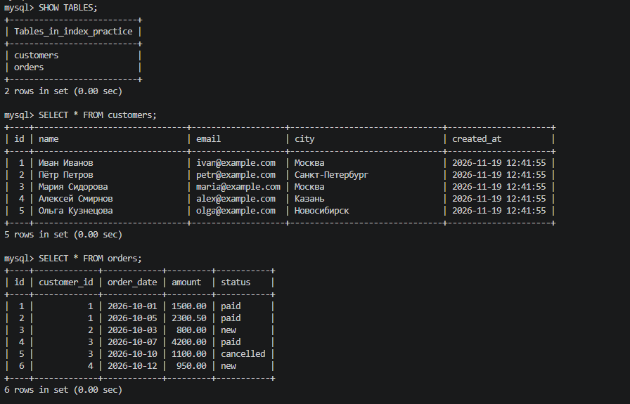
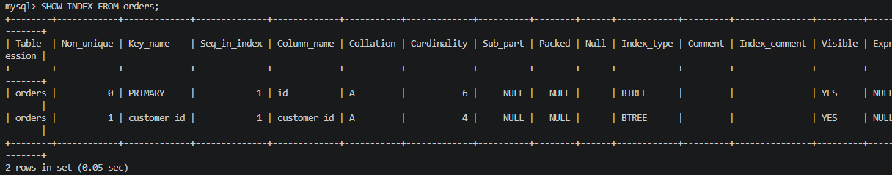
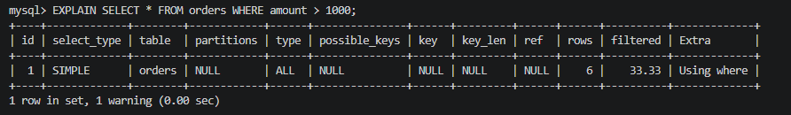
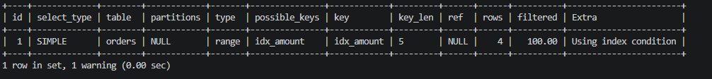
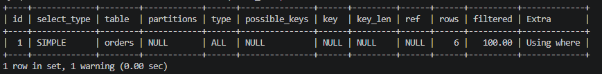
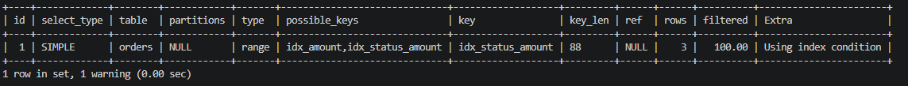
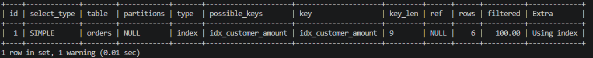
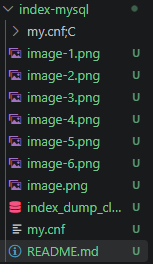
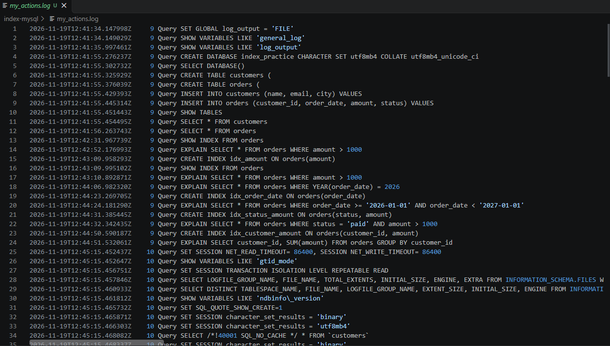

# Лабораторная работа: Индексы в MySQL

## Цель работы
Научиться создавать индексы, читать план выполнения запроса (`EXPLAIN`) и понимать, когда индекс работает, а когда — нет.

## Ход работы
1. Создана база `index_practice` и таблицы `customers`, `orders`.
2. Заполнены таблицы тестовыми данными.
3. Выполнены эксперименты:
   - `EXPLAIN` до индекса (`type: ALL`).
   - Создан индекс `idx_amount` (`type: range`).
   - Демонстрация, что функция `YEAR()` ломает индекс.
   - Создан индекс `idx_order_date` и переписан запрос (используется индекс).
   - Создан составной индекс `idx_status_amount`.
   - Создан покрывающий индекс `idx_customer_amount` (`Using index`).
4. Создан дамп базы (`index_dump_clean.sql`).
5. Выгружен лог действий (`my_actions.log`).

## Скриншоты

### Создание БД и таблиц

### Существующие индексы

### EXPLAIN до индекса

### EXPLAIN после индекса

### Функция ломает индекс

### Составной индекс

### Покрывающий индекс

### Файл дампа

### Файл лога

## Результаты
В папке проекта находятся:
- `index_dump_clean.sql` — дамп базы данных `index_practice`.
- `my_actions.log` — отфильтрованный лог действий пользователя.